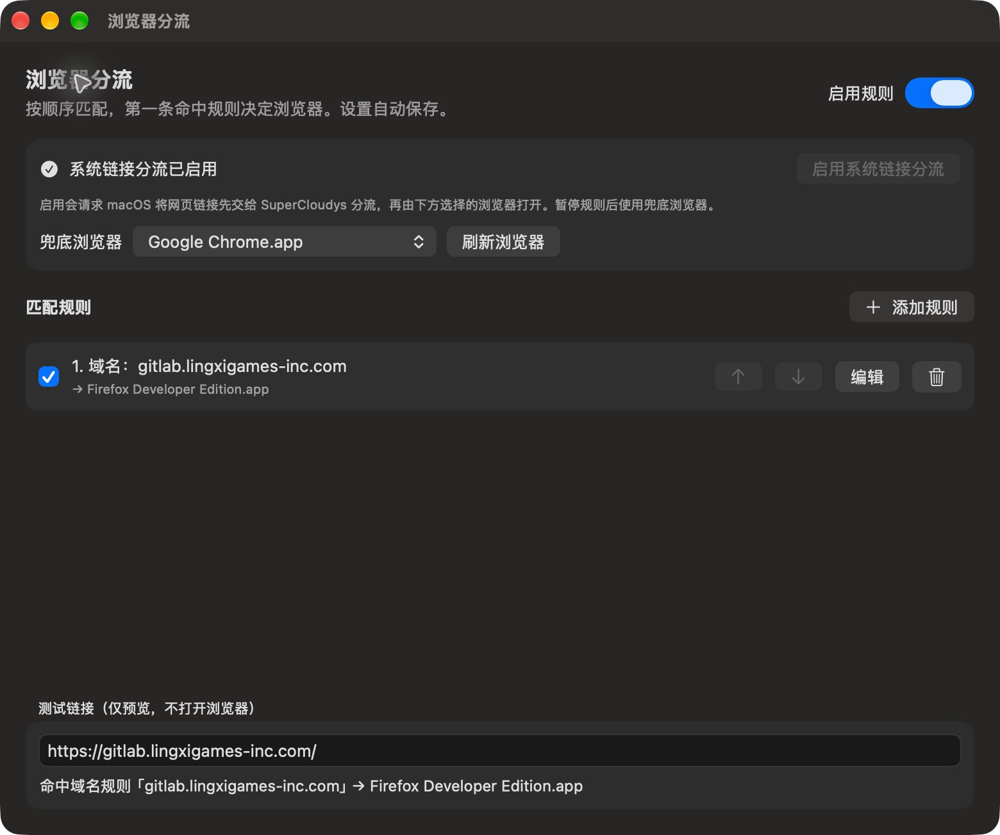
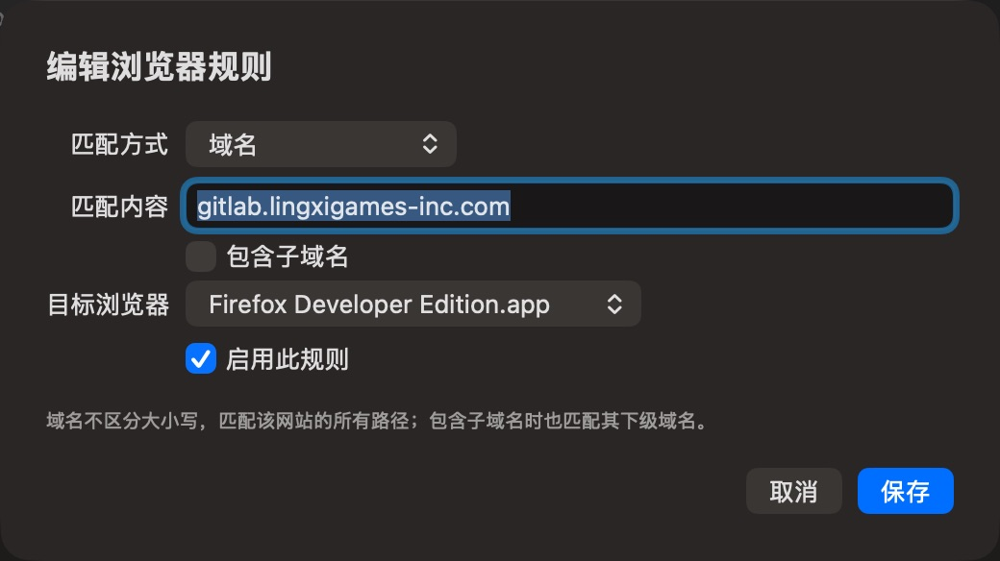
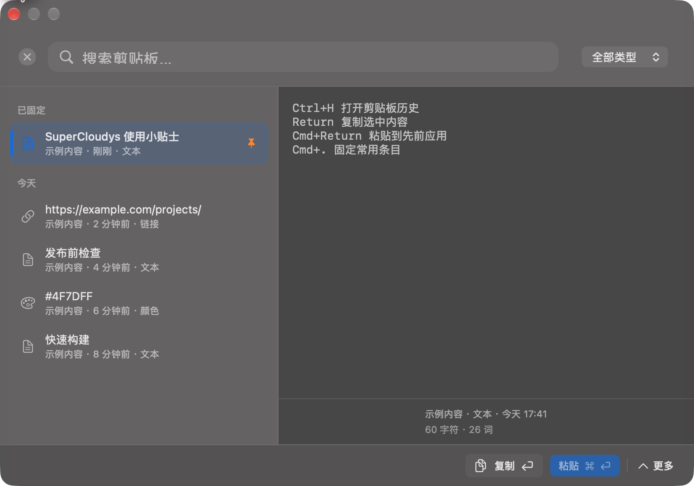

# SuperCloudys

macOS 菜单栏工具：Finder 右键打开、Dock 快捷键、应用默认输入法、浏览器分流和剪贴板历史。需要 macOS 14 或更高版本。

## 安装

从 [Releases](https://github.com/yeshan333/SuperCloudys/releases) 下载 DMG，将 `SuperCloudys.app` 拖入“应用程序”并启动。

按需完成设置：

- **Finder 右键菜单**：在系统设置的“登录项与扩展”中启用 SuperCloudys Finder 扩展。
- **窗口轮换、直接粘贴**：在菜单栏点击“授予辅助功能权限…”。普通复制和启动应用不需要这项权限。
- **浏览器分流**：按下方步骤启用，需要将 SuperCloudys 设为系统默认浏览器。

从源码构建和替换本地安装见[开发说明](docs/development.md)。

## 浏览器分流

**系统默认浏览器必须设为 SuperCloudys，分流才能接收到 VS Code、Zed 等应用交给系统打开的链接。** SuperCloudys 负责转发，网页仍由 Chrome、Firefox 等浏览器显示。

1. 打开菜单栏 →“浏览器分流…”。
2. 检查兜底浏览器和规则。初始配置是：
   - `gitlab.lingxigames-inc.com` 的所有路径 → Firefox Developer Edition，不含子域名。
   - 其他链接 → Google Chrome。
3. 点击“启用系统链接分流”，按 macOS 提示确认，看到“系统链接分流已启用”后再测试。

Chrome 是**兜底浏览器**，SuperCloudys 是**系统链接入口**；应用内的目标浏览器列表不会包含 SuperCloudys。规则预览只检查匹配结果，不会打开网页，也不能证明系统链接分流已启用。

### 规则怎么匹配

按列表顺序使用第一条启用且匹配的规则，可编辑、停用或调整顺序。配置自动保存。

| 类型 | 示例 | 匹配范围 |
| --- | --- | --- |
| 域名 | `gitlab.lingxigames-inc.com` | 该域名下所有路径；可选包含子域名 |
| 路径前缀 | `/projects/` | 以此开头的路径；可额外限定域名 |
| URL 正则 | `^https://example\.com/repo/\d+` | 完整 URL，包括查询参数和片段 |

域名不区分大小写。路径前缀区分大小写，按 URL 编码后的路径匹配，不包含查询参数和片段；`/docs` 也会匹配 `/docs-old`，目录匹配可用 `/docs/`。正则默认区分大小写，可用 `(?i)` 忽略大小写；无效正则不能保存，计算超时视为不匹配。

查看规则编辑器

目标浏览器不可用或打开失败时，依次尝试兜底浏览器、Safari 和其他可用浏览器。暂停规则后，所有收到的链接都交给兜底浏览器。要完全停止分流，在“系统设置 → 桌面与程序坞 → 默认网页浏览器”中改回 Chrome 等浏览器。

分流只处理交给系统默认浏览器的 HTTP/HTTPS 链接。浏览器内部跳转、应用内置网页或明确指定浏览器打开的链接不经过这里。

设为系统默认浏览器时，macOS 也可能把 HTML 文件交给 SuperCloudys。收到的本地 `.html`、`.htm`、`.xhtml` 文件直接用兜底浏览器打开，不匹配网页规则。

## 其他功能

### Finder 右键菜单

选中文件或目录，右键选择通过 VS Code、Zed、Warp、Kaku 打开，或复制完整路径。可在菜单栏添加自定义 `.app`。菜单未出现时，检查扩展是否启用，再点击“刷新状态”。

### Dock 快捷键

`Cmd+1`～`Cmd+9`、`Cmd+0` 对应 Dock 前 10 个固定应用，**默认开启**，可在“Dock 快捷键”菜单关闭。快捷键会启动或聚焦应用；应用已在前台时轮换窗口，最后隐藏。未授予辅助功能权限时，前台操作降级为隐藏。注册冲突会显示在菜单栏。

### 应用默认输入法

在“应用默认输入法 → 添加应用…”选择应用和输入法，再开启“启用自动切换”（默认关闭）。应用进入前台时应用规则，未配置的应用保持当前输入法。在同一应用里手动切换后，直到下次进入该应用才恢复规则。

鼠标旁的输入法提示约 0.8 秒后消失，可单独关闭。输入法切换不需要辅助功能权限。

### 剪贴板历史

`Ctrl+H` 在鼠标附近打开或关闭历史面板，支持文本、URL、文件组、图片和颜色，可搜索、按类型筛选和固定条目。

图中剪贴板内容为示例；截图来自当前源码的界面预览，见[截图说明](screenshots/README.md)。

| 操作 | 快捷键 |
| --- | --- |
| 移动选择 | `↑` / `↓` |
| 复制条目 | `Return` / `Cmd+C` |
| 粘贴到打开面板前的应用 | `Cmd+Return`，或双击条目 |
| 固定 / 取消固定 | `Cmd+.` |
| 删除条目 | `Cmd+Delete` |
| 切换类型 | `Tab` / `Shift+Tab` |
| 关闭面板 | `Esc` |

默认保留最多 **3000 条未固定记录**，不按时间过期；固定条目不受条数和保留期限制。菜单中可暂停记录、调整上限和保留期、排除指定应用；默认排除常见密码管理器。来源应用是采样时的前台应用推断结果。

图片详情支持复制本地图片路径，删除对应记录后图片也会清理。历史数据保存在 `~/Library/Application Support/SuperCloudys/`；存储和损坏恢复机制见[剪贴板实现说明](docs/clipboard-history-design.md)。

### 菜单栏管理

可查看扩展和辅助功能权限状态、设置开机自启，以及查看或修改文件后缀的默认打开应用。

## 开发与维护

- [构建、测试、发布和排查](docs/development.md)
- [剪贴板实现说明](docs/clipboard-history-design.md)
- [易回归问题](docs/BUG_FIX_RECORDS.md)
- [更新记录](CHANGELOG.md)

## License

MIT
